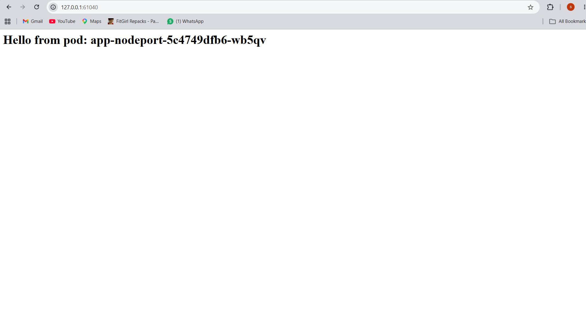

# Assignment 04 - Minikube

## Overview

This assignment sets up a local Kubernetes cluster with **Minikube**, deploys a custom Docker image (a small web app that displays the name of the pod serving the request) as **three deployments**, and exposes them with **three different service types**: NodePort, ClusterIP and LoadBalancer. It then demonstrates how the accessibility of the pods differs for each service type.

| Item | Value |
| --- | --- |
| Operating system | Windows 11 Home (PowerShell 5.1) |
| Minikube driver | Docker (Docker Desktop) |
| Minikube | v1.39.0 |
| Kubernetes (cluster) | v1.37.0 |
| kubectl (client) | v1.36.1 |
| Docker | 29.8.2 |
| Git | 2.55.0 |

## Repository structure

```
minikube-assignment/
├── README.md
├── app/
│   ├── app.py
│   └── Dockerfile
├── k8s/
│   ├── deployments.yaml
│   └── services.yaml
└── screenshots/
    ├── nodeport.png
    └── loadbalancer.png
```

Command used to confirm the folder layout:

```
PS C:\Users\syed shah's\minikube-assignment> dir screenshots

    Directory: C:\Users\syed shah's\minikube-assignment\screenshots

Mode                 LastWriteTime         Length Name
----                 -------------         ------ ----
-a----         11/5/2026   1:59 PM          43692 loadbalancer.png
-a----         11/5/2026   1:47 PM          42759 nodeport.png


PS C:\Users\syed shah's\minikube-assignment> dir

    Directory: C:\Users\syed shah's\minikube-assignment

Mode                 LastWriteTime         Length Name
----                 -------------         ------ ----
d-----         11/5/2026   1:21 PM                app
d-----         11/5/2026   1:32 PM                k8s
d-----         11/5/2026   1:59 PM                screenshots
-a----         11/5/2026   1:58 PM          17249 outputs.txt
```

> Note: `outputs.txt` was only a temporary scratch file used to collect the terminal outputs while working. Its contents were moved into this README and the file was deleted before pushing to GitHub.

---

## Step 0: Project folder setup

**What it does:** creates the project folder and the three sub-folders (`app` for the source code, `k8s` for the YAML manifests, `screenshots` for browser screenshots).

```
PS C:\Users\syed shah's> mkdir minikube-assignment

    Directory: C:\Users\syed shah's

Mode                 LastWriteTime         Length Name
----                 -------------         ------ ----
d-----         11/5/2026   2:21 AM                minikube-assignment


PS C:\Users\syed shah's> cd minikube-assignment
PS C:\Users\syed shah's\minikube-assignment> mkdir app,k8s,screenshots

    Directory: C:\Users\syed shah's\minikube-assignment

Mode                 LastWriteTime         Length Name
----                 -------------         ------ ----
d-----         11/5/2026   2:21 AM                app
d-----         11/5/2026   2:21 AM                k8s
d-----         11/5/2026   2:21 AM                screenshots
```

---

## Step 1: Prerequisites (Git, Docker, kubectl)

| Command | What it does |
| --- | --- |
| `git --version` | Shows the installed Git version. |
| `docker --version` | Shows the installed Docker version. |
| `docker ps` | Lists running containers. It also confirms the Docker engine is running. |
| `winget install -e --id Kubernetes.kubectl` | Installs `kubectl`, the command-line tool used to talk to Kubernetes. |
| `kubectl version --client` | Shows the kubectl client version (confirms the install worked). |

```
PS C:\Users\syed shah's\minikube-assignment> git --version
git version 2.55.0.windows.5
PS C:\Users\syed shah's\minikube-assignment> docker --version
Docker version 29.8.2, build 7fc2dff
PS C:\Users\syed shah's\minikube-assignment> docker ps
CONTAINER ID   IMAGE                                 COMMAND                  CREATED       STATUS        PORTS                                                                                                                                  NAMES
fc1dc05cdded   gcr.io/k8s-minikube/kicbase:v0.0.51   "/usr/local/bin/entr…"   2 weeks ago   Up 15 hours   127.0.0.1:55841->22/tcp, 127.0.0.1:55842->2376/tcp, 127.0.0.1:55839->5000/tcp, 127.0.0.1:55840->8443/tcp, 127.0.0.1:55843->32443/tcp   minikube
PS C:\Users\syed shah's\minikube-assignment> winget install -e --id Kubernetes.kubectl
Found Kubernetes CLI [Kubernetes.kubectl] Version 1.37.2
This application is licensed to you by its owner.
Microsoft is not responsible for, nor does it grant any licenses to, third-party packages.
Downloading https://dl.k8s.io/release/v1.37.2/bin/windows/amd64/kubectl.exe
  60.5 MB / 60.5 MB
Successfully verified installer hash
Starting package install...
Path environment variable modified; restart your shell to use the new value.
Command line alias added: "kubectl"
Successfully installed
```

```
PS C:\Users\syed shah's> cd minikube-assignment
PS C:\Users\syed shah's\minikube-assignment> kubectl version --client
Client Version: v1.36.1
Kustomize Version: v5.8.1
```

**Expected outcome:** all tools print a version, and the `docker ps` output shows that Docker is running (a `minikube` container from an earlier Minikube setup was already present).

---

## Step 2: Minikube installation and verification

Because Docker Desktop is installed, the host OS is used with the **Docker driver**. No separate virtualization platform such as VirtualBox is needed.

| Command | What it does |
| --- | --- |
| `minikube version` | Prints the Minikube version and confirms it is installed. |
| `minikube status` | Shows the state of the cluster components (host, kubelet, apiserver). |
| `kubectl get nodes` | Lists the cluster nodes. A single node named `minikube` in the `Ready` state is expected. |
| `winget install -e --id Kubernetes.minikube` | Official install command for Windows. Minikube was already installed, so winget reported there was nothing to upgrade. |

```
PS C:\Users\syed shah's\minikube-assignment> minikube version
minikube version: v1.39.0
commit: 7a9f6a841470a207de8cf4bafcccee0969d8ba10
PS C:\Users\syed shah's\minikube-assignment> minikube status
minikube
type: Control Plane
host: Running
kubelet: Running
apiserver: Running
kubeconfig: Configured

PS C:\Users\syed shah's\minikube-assignment> kubectl get nodes
NAME       STATUS   ROLES           AGE   VERSION
minikube   Ready    control-plane   19d   v1.37.0
PS C:\Users\syed shah's\minikube-assignment> winget install -e --id Kubernetes.minikube
Found an existing package already installed. Trying to upgrade the installed package...
No available upgrade found.
No newer package versions are available from the configured sources.
```

---

## Step 3: Start the cluster

| Command | What it does |
| --- | --- |
| `minikube start --driver=docker` | Starts the local Kubernetes cluster using the Docker driver. `--driver=docker` tells Minikube to run the cluster inside a Docker container. |
| `minikube status` | Confirms the components are running. |
| `kubectl cluster-info` | Shows the address of the Kubernetes control plane and CoreDNS. |

```
PS C:\Users\syed shah's\minikube-assignment> minikube start --driver=docker
* minikube v1.39.0 on Microsoft Windows 11 Home 26H2
* Using the docker driver based on existing profile
* Starting "minikube" primary control-plane node in "minikube" cluster
* Pulling base image v0.0.51 ...
* Updating the running docker "minikube" container ...
* Preparing Kubernetes v1.37.0 on containerd 2.3.4 ...
* Verifying Kubernetes components...
  - Using image gcr.io/k8s-minikube/storage-provisioner:v5
* Enabled addons: storage-provisioner, default-storageclass
* Done! kubectl is now configured to use "minikube" cluster and "default" namespace by default
PS C:\Users\syed shah's\minikube-assignment> minikube status
minikube
type: Control Plane
host: Running
kubelet: Running
apiserver: Running
kubeconfig: Configured

PS C:\Users\syed shah's\minikube-assignment> kubectl cluster-info
Kubernetes control plane is running at https://127.0.0.1:55840
CoreDNS is running at https://127.0.0.1:55840/api/v1/namespaces/kube-system/services/kube-dns:dns/proxy

To further debug and diagnose cluster problems, use 'kubectl cluster-info dump'.
```

**Expected outcome:** `host`, `kubelet` and `apiserver` are `Running`, `kubeconfig` is `Configured`, and `kubectl cluster-info` prints the control plane address.

---

## Step 4: The application (shows the pod name)

The assignment allows any repository with a Dockerfile. For this assignment a very small **Flask** web app was written. It reads the environment variable `POD_NAME` (which Kubernetes fills with the pod's own name) and displays it. If the variable is missing it falls back to the container hostname, which equals the pod name.

**`app/app.py`**

```python
from flask import Flask
import os, socket

app = Flask(__name__)

@app.route('/')
def home():
    pod = os.environ.get('POD_NAME', socket.gethostname())
    return f'<h1>Hello from pod: {pod}</h1>\n'

if __name__ == '__main__':
    app.run(host='0.0.0.0', port=8080)
```

- `host='0.0.0.0'` makes the app accept connections from outside the container.
- `port=8080` is the port the app listens on inside the pod.

**`app/Dockerfile`**

```dockerfile
FROM python:3.12-slim
WORKDIR /app
RUN pip install --no-cache-dir flask
COPY app.py .
EXPOSE 8080
CMD ["python", "app.py"]
```

| Instruction | Meaning |
| --- | --- |
| `FROM python:3.12-slim` | Small Python base image. |
| `WORKDIR /app` | Working folder inside the container. |
| `RUN pip install --no-cache-dir flask` | Installs Flask. |
| `COPY app.py .` | Copies the app code into the image. |
| `EXPOSE 8080` | Documents that the app listens on port 8080. |
| `CMD ["python", "app.py"]` | Command that runs when the container starts. |

```
PS C:\Users\syed shah's\minikube-assignment> dir app

    Directory: C:\Users\syed shah's\minikube-assignment\app

Mode                 LastWriteTime         Length Name
----                 -------------         ------ ----
-a----         11/5/2026   1:18 PM            277 app.py
-a----         11/5/2026   1:20 PM            139 Dockerfile
```

---

## Step 5: Build the Docker image

`docker build -t pod-name-app:1.0 ./app` builds an image from the Dockerfile in the `app` folder. `-t` gives the image a name and tag (`pod-name-app:1.0`).

```
PS C:\Users\syed shah's\minikube-assignment> docker build -t pod-name-app:1.0 ./app
[+] Building 21.0s (10/10) FINISHED                                                                  docker:desktop-linux
 => [internal] load build definition from Dockerfile                                                             0.0s
 => => transferring dockerfile: 178B                                                                             0.0s
 => [internal] load metadata for docker.io/library/python:3.12-slim                                              3.4s
 => [auth] library/python:pull token for registry-1.docker.io                                                    0.0s
 => [internal] load .dockerignore                                                                                0.0s
 => => transferring context: 2B                                                                                  0.0s
 => [1/4] FROM docker.io/library/python:3.12-slim@sha256:b18b261e1b4974b4f321451ad5251ded85abb22c2b8b262da527dda1 9.0s
 => => resolve docker.io/library/python:3.12-slim@sha256:b18b261e1b4974b4f321451ad5251ded85abb22c2b8b262da527dda1 0.0s
 => => sha256:acca7542dfc736e9ce20cbefc58b2d09822276d15d4a0c531531a6f1b057928e 251B / 251B                       0.3s
 => => sha256:f574edac59d9f092df596f54e5b52656c803fd3ae30825b8ee5a189ed05f63d3 12.12MB / 12.12MB                 2.3s
 => => sha256:3eb77115150676568f88e2957181b8f7e3014e797f1ce8cd640086dfbed45e35 1.29MB / 1.29MB                   1.8s
 => => sha256:6fc242d221a673263eabd14a9ad9584d3177c96e5cb504c891497338e2f912f5 29.86MB / 29.86MB                 8.0s
 => => extracting sha256:6fc242d221a673263eabd14a9ad9584d3177c96e5cb504c891497338e2f912f5                        0.6s
 => => extracting sha256:3eb77115150676568f88e2957181b8f7e3014e797f1ce8cd640086dfbed45e35                        0.1s
 => => extracting sha256:f574edac59d9f092df596f54e5b52656c803fd3ae30825b8ee5a189ed05f63d3                        0.3s
 => => extracting sha256:acca7542dfc736e9ce20cbefc58b2d09822276d15d4a0c531531a6f1b057928e                        0.0s
 => [internal] load build context                                                                                0.0s
 => => transferring context: 312B                                                                                0.0s
 => [2/4] WORKDIR /app                                                                                           0.1s
 => [3/4] RUN pip install --no-cache-dir flask                                                                   6.8s
 => [4/4] COPY app.py .                                                                                          0.0s
 => exporting to image                                                                                           1.5s
 => => exporting layers                                                                                          0.4s
 => => exporting manifest sha256:dedf9295aa2df5395f9f5e3feaeb88f27d8363657f169db9b82cc3315209cca7                0.0s
 => => exporting config sha256:f5e2f3ace7e2aec464deed0d048e0eef4efc0a932b4a67c7ad634f9c3b64a0bd                  0.0s
 => => exporting attestation manifest sha256:62040a23eca6b315fbcb5fbd2d7b5cdbf1affcde090ae653e18d3213c46c174f    0.0s
 => => exporting manifest list sha256:ba74e46e7152d731b7e36c0121e3d5b9773e1f5578d22482c174c143566d3249           0.0s
 => => naming to docker.io/library/pod-name-app:1.0                                                              0.0s
 => => unpacking to docker.io/library/pod-name-app:1.0                                                           1.0s
PS C:\Users\syed shah's\minikube-assignment> docker images pod-name-app

IMAGE               ID             DISK USAGE   CONTENT SIZE   EXTRA
pod-name-app:1.0    ba74e46e7152        198MB         48.3MB
```

**Expected outcome:** the build finishes (`10/10 FINISHED`) and `docker images` lists `pod-name-app:1.0`.

---

## Step 6: Load the image into Minikube

The pods run **inside** the Minikube cluster, which has its own image store (this cluster uses the `containerd` runtime). An image built in Docker Desktop is not visible there automatically, so it is copied in with `minikube image load`.

| Command | What it does |
| --- | --- |
| `minikube image load pod-name-app:1.0` | Copies the image from the local Docker into the Minikube cluster. |
| `minikube image ls \| findstr pod-name-app` | Lists images inside Minikube and filters for ours. |

```
PS C:\Users\syed shah's\minikube-assignment> minikube image load pod-name-app:1.0
PS C:\Users\syed shah's\minikube-assignment> minikube image ls | findstr pod-name-app
docker.io/library/pod-name-app:1.0
```

---

## Step 7: Create three deployments

**`k8s/deployments.yaml`** defines three Deployments (`app-nodeport`, `app-clusterip`, `app-loadbalancer`). All three use the same custom image and run 2 replicas each.

```yaml
apiVersion: apps/v1
kind: Deployment
metadata:
  name: app-nodeport
spec:
  replicas: 2
  selector:
    matchLabels:
      app: app-nodeport
  template:
    metadata:
      labels:
        app: app-nodeport
    spec:
      containers:
      - name: web
        image: pod-name-app:1.0
        imagePullPolicy: Never
        ports:
        - containerPort: 8080
        env:
        - name: POD_NAME
          valueFrom:
            fieldRef:
              fieldPath: metadata.name
---
apiVersion: apps/v1
kind: Deployment
metadata:
  name: app-clusterip
spec:
  replicas: 2
  selector:
    matchLabels:
      app: app-clusterip
  template:
    metadata:
      labels:
        app: app-clusterip
    spec:
      containers:
      - name: web
        image: pod-name-app:1.0
        imagePullPolicy: Never
        ports:
        - containerPort: 8080
        env:
        - name: POD_NAME
          valueFrom:
            fieldRef:
              fieldPath: metadata.name
---
apiVersion: apps/v1
kind: Deployment
metadata:
  name: app-loadbalancer
spec:
  replicas: 2
  selector:
    matchLabels:
      app: app-loadbalancer
  template:
    metadata:
      labels:
        app: app-loadbalancer
    spec:
      containers:
      - name: web
        image: pod-name-app:1.0
        imagePullPolicy: Never
        ports:
        - containerPort: 8080
        env:
        - name: POD_NAME
          valueFrom:
            fieldRef:
              fieldPath: metadata.name
```

**Important configuration options:**

| Option | Meaning |
| --- | --- |
| `replicas: 2` | Run 2 identical pods per deployment. |
| `selector.matchLabels` / `template.metadata.labels` | The label (`app: app-...`) that ties the pods to their deployment and later to their service. |
| `image: pod-name-app:1.0` | The custom image built in Step 5. |
| `imagePullPolicy: Never` | Do not download the image from the internet. Use the copy that was loaded into Minikube in Step 6. |
| `containerPort: 8080` | The port the app listens on inside the pod. |
| `env POD_NAME` with `fieldRef: metadata.name` | The Kubernetes downward API fills `POD_NAME` with the pod's own name, which the app then displays. |

| Command | What it does |
| --- | --- |
| `kubectl apply -f k8s/deployments.yaml` | Creates the deployments described in the file. |
| `kubectl get deployments` | Lists the deployments and how many pods are ready. |
| `kubectl get pods -o wide` | Lists all pods with their IP addresses and node. |

```
PS C:\Users\syed shah's\minikube-assignment> dir k8s

    Directory: C:\Users\syed shah's\minikube-assignment\k8s

Mode                 LastWriteTime         Length Name
----                 -------------         ------ ----
-a----         11/5/2026   1:29 PM           1636 deployments.yaml


PS C:\Users\syed shah's\minikube-assignment> kubectl apply -f k8s/deployments.yaml
deployment.apps/app-nodeport created
deployment.apps/app-clusterip created
deployment.apps/app-loadbalancer created
PS C:\Users\syed shah's\minikube-assignment> kubectl get deployments
NAME               READY   UP-TO-DATE   AVAILABLE   AGE
app-clusterip      2/2     2            2           6s
app-loadbalancer   2/2     2            2           6s
app-nodeport       2/2     2            2           6s
PS C:\Users\syed shah's\minikube-assignment> kubectl get pods -o wide
NAME                                READY   STATUS    RESTARTS   AGE   IP            NODE       NOMINATED NODE   READINESS GATES
app-clusterip-55579cbd98-9q5mz      1/1     Running   0          13s   10.244.0.3    minikube   <none>           <none>
app-clusterip-55579cbd98-jtt7m      1/1     Running   0          13s   10.244.0.8    minikube   <none>           <none>
app-loadbalancer-7cdffb9865-cfwwm   1/1     Running   0          13s   10.244.0.6    minikube   <none>           <none>
app-loadbalancer-7cdffb9865-g7r2f   1/1     Running   0          13s   10.244.0.5    minikube   <none>           <none>
app-nodeport-5c4749dfb6-fhp6t       1/1     Running   0          13s   10.244.0.4    minikube   <none>           <none>
app-nodeport-5c4749dfb6-wb5qv       1/1     Running   0          13s   10.244.0.7    minikube   <none>           <none>
```

**Expected outcome:** three deployments, each `2/2 READY`, and six pods in the `Running` state.

---

## Step 8: Create three services

**`k8s/services.yaml`** creates one service per deployment.

```yaml
apiVersion: v1
kind: Service
metadata:
  name: app-nodeport-svc
spec:
  type: NodePort
  selector:
    app: app-nodeport
  ports:
  - port: 80
    targetPort: 8080
    nodePort: 30080
---
apiVersion: v1
kind: Service
metadata:
  name: app-clusterip-svc
spec:
  type: ClusterIP
  selector:
    app: app-clusterip
  ports:
  - port: 80
    targetPort: 8080
---
apiVersion: v1
kind: Service
metadata:
  name: app-loadbalancer-svc
spec:
  type: LoadBalancer
  selector:
    app: app-loadbalancer
  ports:
  - port: 80
    targetPort: 8080
```

**Important configuration options:**

| Option | Meaning |
| --- | --- |
| `type` | Service type: `NodePort`, `ClusterIP` or `LoadBalancer`. |
| `selector` | Connects the service to the pods carrying that label, so each service is tied to exactly one deployment. |
| `port: 80` | The port of the service itself. |
| `targetPort: 8080` | The port inside the pod where traffic is forwarded. |
| `nodePort: 30080` | (NodePort only) the port opened on the node. The allowed range is 30000-32767. |

| Command | What it does |
| --- | --- |
| `kubectl apply -f k8s/services.yaml` | Creates the services. |
| `kubectl get services` | Lists services with their type, cluster IP, external IP and ports. |
| `kubectl get endpoints` | Shows which pod IPs sit behind each service. |

```
PS C:\Users\syed shah's\minikube-assignment> dir k8s

    Directory: C:\Users\syed shah's\minikube-assignment\k8s

Mode                 LastWriteTime         Length Name
----                 -------------         ------ ----
-a----         11/5/2026   1:29 PM           1636 deployments.yaml
-a----         11/5/2026   1:33 PM            704 services.yaml


PS C:\Users\syed shah's\minikube-assignment> kubectl apply -f k8s/services.yaml
service/app-nodeport-svc created
service/app-clusterip-svc created
service/app-loadbalancer-svc created
PS C:\Users\syed shah's\minikube-assignment> kubectl get services
NAME                   TYPE           CLUSTER-IP       EXTERNAL-IP   PORT(S)        AGE
app-clusterip-svc      ClusterIP      10.104.214.139   <none>        80/TCP         6s
app-loadbalancer-svc   LoadBalancer   10.104.220.120   <pending>     80:30479/TCP   6s
app-nodeport-svc       NodePort       10.104.96.41     <none>        80:30080/TCP   6s
kubernetes             ClusterIP      10.96.0.1        <none>        443/TCP        19d
PS C:\Users\syed shah's\minikube-assignment> kubectl get endpoints
Warning: v1 Endpoints is deprecated in v1.33+; use discovery.k8s.io/v1 EndpointSlice
NAME                   ENDPOINTS                         AGE
app-clusterip-svc      10.244.0.3:8080,10.244.0.8:8080   14s
app-loadbalancer-svc   10.244.0.5:8080,10.244.0.6:8080   14s
app-nodeport-svc       10.244.0.4:8080,10.244.0.7:8080   14s
kubernetes             192.168.49.2:8443                 19d
```

**Expected outcome:**

- `app-nodeport-svc` is of type `NodePort` with ports `80:30080/TCP`.
- `app-clusterip-svc` is of type `ClusterIP` with `EXTERNAL-IP <none>`.
- `app-loadbalancer-svc` is of type `LoadBalancer`. Its `EXTERNAL-IP` is `<pending>` until `minikube tunnel` is started (Step 11).
- Each service lists the two pod IPs of its own deployment under endpoints (the `Warning` line about `v1 Endpoints` is only a deprecation notice from newer Kubernetes versions).

---

## Step 9: Accessibility demonstration - ClusterIP

### Why pods behind a ClusterIP service are not reachable from outside the cluster

A ClusterIP service gets a **virtual IP that exists only on the cluster's internal network**. `kube-proxy` sets up routing rules on the cluster nodes so that traffic sent to this virtual IP from **inside** the cluster is forwarded to one of the matching pods. The IP is not bound to a real network interface on the host computer, no port is opened on the node or on the host, and there is no external load balancer in front of it. A client outside the cluster (for example the browser or a terminal on the host machine) therefore has no route to this IP.

### Test 1: from outside the cluster (expected to fail)

`curl.exe --max-time 5 http://10.104.214.139` tries to reach the ClusterIP from the host computer and gives up after 5 seconds.

### Test 2: from inside the cluster (expected to work)

`kubectl run curl-test --rm -it --image=curlimages/curl --restart=Never -- curl -s http://app-clusterip-svc` starts a temporary pod inside the cluster that calls the service by its name. `--rm` deletes the pod when finished and `--restart=Never` makes it a one-time pod.

```
PS C:\Users\syed shah's\minikube-assignment> kubectl get svc app-clusterip-svc
NAME                TYPE        CLUSTER-IP       EXTERNAL-IP   PORT(S)   AGE
app-clusterip-svc   ClusterIP   10.104.214.139   <none>        80/TCP    99s
PS C:\Users\syed shah's\minikube-assignment> curl.exe --max-time 5 http://10.104.214.139
curl: (28) Connection timed out after 5005 milliseconds
PS C:\Users\syed shah's\minikube-assignment> kubectl run curl-test --rm -it --image=curlimages/curl --restart=Never -- curl -s http://app-clusterip-svc
<h1>Hello from pod: app-clusterip-55579cbd98-jtt7m</h1>
All commands and output from this session will be recorded in container logs, including credentials and sensitive information passed through the command prompt.
If you don't see a command prompt, try pressing enter.
warning: couldn't attach to pod/curl-test, falling back to streaming logs: Internal error occurred: Internal error occurred: error attaching to container: container is in CONTAINER_EXITED state
<h1>Hello from pod: app-clusterip-55579cbd98-jtt7m</h1>
pod "curl-test" deleted from default namespace
PS C:\Users\syed shah's\minikube-assignment> kubectl run curl-test --rm -it --image=curlimages/curl --restart=Never -- curl -s http://app-clusterip-svc
All commands and output from this session will be recorded in container logs, including credentials and sensitive information passed through the command prompt.
If you don't see a command prompt, try pressing enter.
Session ended, resume using 'kubectl attach curl-test -c curl-test -n default -i -t' command
pod "curl-test" deleted from default namespace
PS C:\Users\syed shah's\minikube-assignment> kubectl run curl-test --rm -it --image=curlimages/curl --restart=Never -- curl -s http://app-clusterip-svc
<h1>Hello from pod: app-clusterip-55579cbd98-9q5mz</h1>
All commands and output from this session will be recorded in container logs, including credentials and sensitive information passed through the command prompt.
If you don't see a command prompt, try pressing enter.
warning: couldn't attach to pod/curl-test, falling back to streaming logs: unable to open upgrade connection: container curl-test not found in pod curl-test_default
<h1>Hello from pod: app-clusterip-55579cbd98-9q5mz</h1>
pod "curl-test" deleted from default namespace
```

**Result:** from outside, the request **timed out** (`Connection timed out`), so a ClusterIP service is not accessible outside the cluster. From inside, the page was returned, and the pod name changed between runs (`...jtt7m` and `...9q5mz`), which shows the service load-balances between its two pods. (The `warning: couldn't attach...` lines come from the interactive `-it` option of `kubectl run` and do not affect the result. The second run printed no page because the temporary pod exited before the terminal attached to it.)

---

## Step 10: Accessibility demonstration - NodePort

A NodePort service opens a port (here `30080`) on every node **and** also keeps a ClusterIP. So the pods can be reached from inside the cluster, from the node itself, and from the host machine through the node.

### From inside the cluster

`kubectl run curl-test --rm -i ... -- curl -s http://app-nodeport-svc` calls the service by name from a temporary pod.

### From the node itself

`minikube ssh -- curl -s http://localhost:30080` logs in to the Minikube node and calls the NodePort `30080` on it.

```
PS C:\Users\syed shah's\minikube-assignment> kubectl run curl-test --rm -i --image=curlimages/curl --restart=Never -- curl -s http://app-nodeport-svc
<h1>Hello from pod: app-nodeport-5c4749dfb6-wb5qv</h1>
All commands and output from this session will be recorded in container logs, including credentials and sensitive information passed through the command prompt.
If you don't see a command prompt, try pressing enter.
warning: couldn't attach to pod/curl-test, falling back to streaming logs: Internal error occurred: Internal error occurred: error attaching to container: container is in CONTAINER_EXITED state
<h1>Hello from pod: app-nodeport-5c4749dfb6-wb5qv</h1>
pod "curl-test" deleted from default namespace
PS C:\Users\syed shah's\minikube-assignment> minikube ssh -- curl -s http://localhost:30080
<h1>Hello from pod: app-nodeport-5c4749dfb6-wb5qv</h1>
```

### From the host machine (browser)

`minikube service app-nodeport-svc --url` creates a local URL on the host that forwards to the NodePort service. With the Docker driver on Windows this terminal must stay open while the URL is used.

```
PS C:\Users\syed shah's> cd minikube-assignment
PS C:\Users\syed shah's\minikube-assignment> minikube service app-nodeport-svc --url
http://127.0.0.1:61040
! Because you are using a Docker driver on windows, the terminal needs to be open to run it.
```

Opening `http://127.0.0.1:61040` in the browser shows the pod name:



**Result:** the pods behind the NodePort service answered from inside the cluster, from the node (`localhost:30080`) and from the host browser.

---

## Step 11: Accessibility demonstration - LoadBalancer

Minikube has no cloud load balancer, so it emulates one with `minikube tunnel`. This command creates a route from the host to the cluster and assigns an `EXTERNAL-IP` to LoadBalancer services. The terminal running it must stay open.

```
PS C:\Users\syed shah's> cd minikube-assignment\
PS C:\Users\syed shah's\minikube-assignment> minikube tunnel
* Tunnel successfully started

* NOTE: Please do not close this terminal as this process must stay alive for the tunnel to be accessible ...

! Access to ports below 1024 may fail on Windows with OpenSSH clients older than v8.1. For more information, see: https://minikube.sigs.k8s.io/docs/handbook/accessing/#access-to-ports-1024-on-windows-requires-root-permission
* Starting tunnel for service app-loadbalancer-svc.
```

In a second terminal the service status was checked. Before the tunnel the `EXTERNAL-IP` was `<pending>` (see Step 8). Now it has an address:

```
PS C:\Users\syed shah's> cd minikube-assignment
PS C:\Users\syed shah's\minikube-assignment> kubectl get svc app-loadbalancer-svc
NAME                   TYPE           CLUSTER-IP       EXTERNAL-IP   PORT(S)        AGE
app-loadbalancer-svc   LoadBalancer   10.104.220.120   127.0.0.1     80:30479/TCP   22m
```

Calling the external IP from the host machine (outside the cluster). The request was sent 6 times:

```
PS C:\Users\syed shah's\minikube-assignment> curl.exe http://127.0.0.1
<h1>Hello from pod: app-loadbalancer-7cdffb9865-cfwwm</h1>
PS C:\Users\syed shah's\minikube-assignment> 1..6 | ForEach-Object { curl.exe -s http://127.0.0.1 }
<h1>Hello from pod: app-loadbalancer-7cdffb9865-g7r2f</h1>
<h1>Hello from pod: app-loadbalancer-7cdffb9865-g7r2f</h1>
<h1>Hello from pod: app-loadbalancer-7cdffb9865-g7r2f</h1>
<h1>Hello from pod: app-loadbalancer-7cdffb9865-g7r2f</h1>
<h1>Hello from pod: app-loadbalancer-7cdffb9865-g7r2f</h1>
<h1>Hello from pod: app-loadbalancer-7cdffb9865-cfwwm</h1>
```

Opening `http://127.0.0.1` in the browser:


**Result:** the LoadBalancer service is reachable **from outside the cluster** through its external IP, and the replies came from both pods (`...g7r2f` and `...cfwwm`), which shows the traffic is balanced across the two replicas.

---

## Summary table

| Service type | Reachable inside the cluster | Reachable from the host / outside | How it was accessed |
| --- | --- | --- | --- |
| ClusterIP | Yes | No (request timed out) | Temporary `curl` pod inside the cluster |
| NodePort | Yes | Yes, through the node on port 30080 | `minikube ssh` + `localhost:30080`, and `minikube service --url` in the browser |
| LoadBalancer | Yes | Yes, through the external IP | `minikube tunnel` + `EXTERNAL-IP` (`127.0.0.1`) |

---

## Cleanup (optional, after the demonstration)

These commands remove everything that was created:

```
kubectl delete -f k8s/services.yaml      # deletes the three services
kubectl delete -f k8s/deployments.yaml   # deletes the three deployments and their pods
minikube stop                            # stops the cluster (use "minikube delete" to remove it completely)
```

---

## References / Citations

- Minikube documentation: https://minikube.sigs.k8s.io/docs/start/
- Minikube - accessing apps (NodePort, LoadBalancer and `minikube tunnel`): https://minikube.sigs.k8s.io/docs/handbook/accessing/
- Kubernetes Services: https://kubernetes.io/docs/concepts/services-networking/service/
- Kubernetes Deployments: https://kubernetes.io/docs/concepts/workloads/controllers/deployment/
- Expose pod information to containers (downward API): https://kubernetes.io/docs/tasks/inject-data-application/environment-variable-expose-pod-information/
- Docker documentation: https://docs.docker.com/

The application used in this assignment is a small Flask app written for this assignment (not taken from an external repository).
